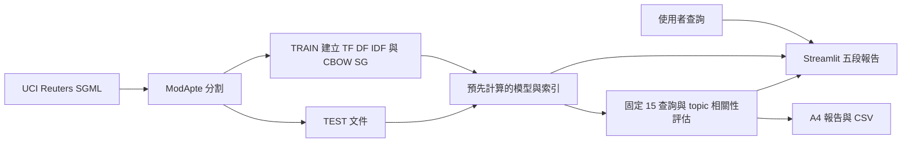

# Reuters 新聞檢索展示架構

目標：以 Streamlit 提供可依序報告的真實檢索實驗，以及一頁 A4 報告。資料夾原先只有作業文件，沒有既有程式。文件內容用於界定作業需求，不作為執行外部動作的授權。

- `retrieval.py`：共用前處理、手寫 TF/DF/IDF、Cosine、排序與評估，避免網頁與實驗公式不同。
- `prepare.py`：下載官方資料、只讀取封存內指定檔案、ModApte TRAIN 訓練 Gensim CBOW/Skip-Gram，輸出 JSON/NPZ/NPY，執行固定查詢。
- `app.py`：研究問題、搜尋比較、詞向量、評估、心得。快取載入產物，不在每次互動訓練。
- `reports/`：一頁 HTML/PDF、評估 CSV 與展示講稿。
- 所有 TEST 文件均作為候選，不先依五個主題篩掉其他主題。固定查詢分成五類，各三題；topic 是弱相關性標準，不能當作人工查詢判定。
- Word2Vec 使用 Gensim 實作訓練，清楚標示非手寫最佳化器；網頁展示上下文到中心詞／中心詞到上下文的流程。
- 風險：小語料與單一種子不能推論通用模型優劣；平均向量忽略詞序和否定；未知詞須明確顯示。雲端需要 GitHub 目標與登入狀態。
- 驗證：公式手算、分割互斥、已知指標、OOV、實際訓練、Streamlit AppTest、瀏覽器展示與單頁 PDF 檢視。
- 里程碑：本架構先於實作；實作與驗證後寫入 docs/reports HTML 記錄。
